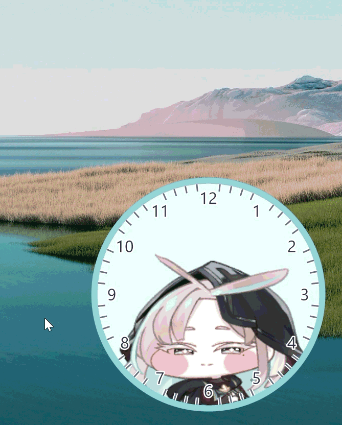

> 이 프로그램은 AI를 활용하여 제작했습니다.

**한국어** · [English](docs/main/README.en.md) · [日本語](docs/main/README.ja.md)

# Skea Clock

> **스키아의 바보털은 세계제일**


스키아를 시계로 써봅시다. 컴퓨터 화면에 띄우고 시계를 보거나 볼을 당기거나 쓰다듬을 수 있어요.
다른 사도들도 있어요!

## 다운로드

별도의 설치는 필요 없습니다.

- [최신 버전 다운로드](https://github.com/junhwan123/SkeaClock/releases/latest/download/SkeaClock.exe)
- [저해상도 버전 다운로드](https://github.com/junhwan123/SkeaClock/releases/latest/download/SkeaClock_low.exe)

`.exe` 파일을 다운받고 실행하면 됩니다.
만약 사용시 렉이 걸리거나 저사양 · 저용량 버전을 원한다면 저해상도 버전을 다운받으세요.

### 에셋 폴더

이 파일은 실행 시 에셋 폴더를 `APPDATA` 폴더에 생성합니다.

```text
\AppData\Local\SkeaClock
```

`.exe` 파일을 삭제하더라도 해당 폴더는 사라지지 않으니 만약 완벽한 삭제를 원하는 경우 해당 폴더도 지워주세요.

## 사용 가이드



시계를 처음 실행하면 우측 하단에 창이 뜹니다.

**우클릭**을 누르면 설정 창이 뜹니다. 설정 창에서 시계 디자인을 바꾸거나, 위치·크기를 변경하거나, 캐릭터를 변경할 수 있습니다.

그 외에도 여러 설정이 있으니 확인해보세요.

## 캐릭터

각 캐릭터마다 기능이 약간씩 다릅니다.
각 캐릭터마다 자세한 기능 설명은 아래에서 확인 가능합니다.

- **[스키아](docs/skea/README.md)**  
  아날로그 시계로 작동합니다. 알람 기능을 사용할 수 있습니다.
- **[뮤트](docs/mute/README.md)**  
  디지털 시계로 작동합니다. 스키아와 공유되는 알람 기능을 사용할 수 있습니다.
- **[코미](docs/kommy/README.md)**  
  타이머로 작동합니다. 혀를 돌려 타이머를 감을 수 있고 시간이 되면 알람이 짧게 울립니다.
- **[코페](docs/coffe/README.md)**  
  노래 플레이어로 작동합니다. 원하는 노래를 선택해 백그라운드에서 재생할 수 있고, 커피를 만들 수도 있어요!

공통 기능에 대한 설명도 적혀있으니 확인해보세요.

## 언어

이 프로그램은 현재 한국어, 일본어, 영어, 중국어(간체)를 지원합니다.

번역은 직접 진행할 수도 있으며, 직접 만든 언어 파일을 프로그램에 적용해 사용할 수도 있습니다.
언어 파일은 [language-editor.html](languages/language-editor.html)을 통해 만들 수 있습니다.

자세한 내용은 [Language-README.md](languages/Language-README.md)를 참고해주세요.

### 번역 도움

중국어(간체): MUYANG

## 2차 창작 가이드라인

Skea Clock은 에피드게임즈의 《트릭컬 리바이브》를 바탕으로 만든 비공식 2차 창작 프로그램입니다. 에피드게임즈의 2차 창작 가이드라인이 허용하는 범위에서 제작하고 배포합니다. [에피드게임즈 공식 2차 창작 가이드라인](https://epidgames.oqupie.com/portal/2399)

원작의 캐릭터와 설정 등 원작 콘텐츠에 관한 권리는 에피드게임즈와 해당 권리자에게 귀속됩니다.

에피드게임즈 또는 관련 권리자의 요청이 있을 경우, 해당 자료를 수정·삭제하거나 프로그램의 공개 및 배포를 중단할 수 있습니다.

