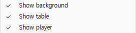
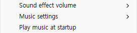
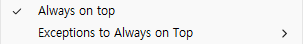
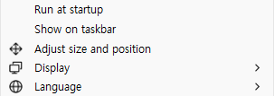
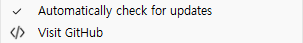

# Coffe player

[한국어](README.md) · **English** · [日本語](README.ja.md)

[Back to the main README](../main/README.en.md)

[Skea](../skea/README.en.md) · [Mute](../mute/README.en.md) · [Kommy](../kommy/README.en.md)

Coffe is a music player.  
Use the button at the lower right to play a track of your choice.  
You can also ask Coffe to make you coffee.

### Clock appearance

Turn **Show background** and **Show table** on or off individually to change the appearance.  
Use **Show player** to toggle the music player button.

### Making coffee

Enable **Show table** to make the coffee bag appear. Give it to Coffe to start making coffee.  
Hand over the pot and cup when they appear. You might get a special cup of coffee!

### Music player

Once you select a track in **Music settings**, click the player button to start playback.  
The track loops and keeps playing when you switch characters.  
Click the button again to pause.

### Sound settings

Use **Sound effect volume** to adjust effects and **Music settings** to choose a track or adjust its volume.

Select **Choose music file...** to choose your track.  
You can select an audio or video file from your computer. The app rejects files it cannot play.  
Moving or deleting the original file clears the selection.

## Shared features

### Always on top

Enable **Always on top** to keep the clock visible while you use other apps.  
Clear the check mark to let other windows cover the clock.

Choose an app under **Exceptions to Always on Top** to add it to the exceptions.  
The clock goes behind that app while you use it and returns to the top when you switch to another app.

If the program is missing from the list, use **Choose program...** to add its executable directly.

### Other settings

**Run at startup** adds Skea Clock to the Windows startup list.  
The program then opens automatically when Windows starts.

**Show on taskbar** puts the clock on the Windows taskbar.

Use **Adjust size and position** to move or resize the clock.

Use **Display** to choose the screen where the clock appears.  
Skea Clock saves the size and position separately for each screen.

Use **Language** to change the interface language.

Use **Choose language file...** to add a custom language.  
See the editor guide for how to create a language file. [Language-README.md](../../languages/Language-README.md)

### Updates

With **Automatically check for updates** enabled, Skea Clock checks GitHub for updates at startup, at most once every seven days.

Use **Visit GitHub** to check for updates yourself.
