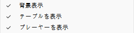
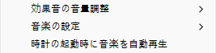
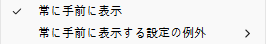
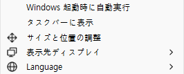
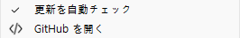

# コーフェ（Coffe player）

[한국어](README.md) · [English](README.en.md) · **日本語**

[メイン README に戻る](../main/README.ja.md)

[スキア](../skea/README.ja.md) · [ミュート](../mute/README.ja.md) · [コミー](../kommy/README.ja.md)

コーフェの音楽プレーヤーです。  
右下のボタンでお好みの曲を再生できます。  
コーフェにコーヒーを淹れてもらうこともできます。

### 時計の見た目

**背景表示**と**テーブルを表示**を個別にオン・オフにして、見た目を変えられます。  
**プレーヤーを表示**で音楽プレーヤーのボタンの表示を切り替えられます。

### コーヒーの淹れ方

**テーブルを表示**をオンにすると、コーヒー豆の袋が現れます。コーフェに渡すと、コーヒーを淹れ始めます。  
ポットとカップも順に渡しましょう。たまに特別なコーヒーがもらえるかも？

### 音楽プレーヤー

**音楽の設定**で曲を選んでおくと、プレーヤーのボタンを押して再生できます。  
曲は繰り返し再生され、別のキャラクターに切り替えても流れ続けます。  
もう一度ボタンを押すと一時停止します。

### サウンド設定

**効果音の音量調整**で効果音の音量を、**音楽の設定**で曲とその音量を設定できます。

**音楽ファイルを選択...**でお好みの曲を選べます。  
パソコン上の音声ファイルや動画ファイルを使用できます。再生できないファイルを選択した場合は、自動で選択が取り消されます。  
元のファイルを移動または削除すると、選択が解除されます。

## 共通機能

### 常に手前に表示

**常に手前に表示**をオンにすると、ほかのプログラムを使っている間も時計を確認できます。  
チェックを外すと、ほかのウィンドウが時計に重なることがあります。

**常に手前に表示する設定の例外**で、例外にしたいプログラムを選べます。  
そのプログラムを使っている間は時計が背後に回り、別のプログラムに切り替えると再び手前に表示されます。

一覧に目的のプログラムがない場合は、**プログラムを選択...**から実行ファイルを直接追加できます。

### その他の設定

**Windows 起動時に自動実行**をオンにすると、Skea ClockがWindowsのスタートアップに登録されます。  
Windowsの起動時に自動で立ち上がります。

**タスクバーに表示**をオンにすると、時計がWindowsのタスクバーに表示されます。

**サイズ・位置の調整**で時計のサイズと位置を変えられます。

**表示先ディスプレイ**で時計を表示する画面を選べます。  
サイズと位置は画面ごとに保存されます。

**Language**で表示言語を変更できます。

**言語ファイルを選択...**から独自の言語ファイルを追加できます。  
作成方法は言語エディターのガイドをご覧ください。[Language-README.md（英語）](../../languages/Language-README.md)

### 更新管理

**更新を自動チェック**をオンにすると、起動時に7日間隔でGitHubに更新があるか確認します。

**GitHub を開く**から手動でも更新を確認できます。
