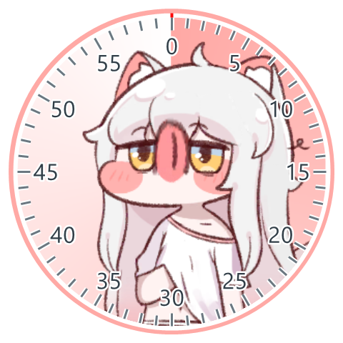
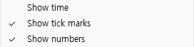
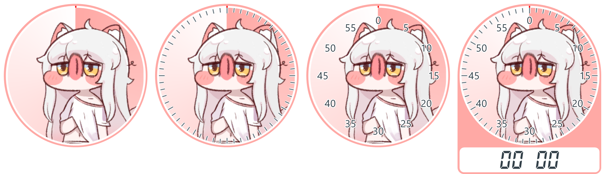
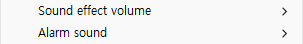
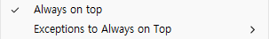
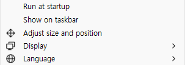
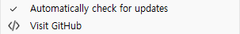

# Kommy timer

[한국어](README.md) · **English** · [日本語](README.ja.md)

[Back to the main README](../main/README.en.md)

[Skea](../skea/README.en.md) · [Mute](../mute/README.en.md) · [Coffe](../coffe/README.en.md)

Kommy is a timer.  
Right-click to toggle the countdown display, tick marks, and dial numbers. Turn Kommy's tongue to set the timer alarm.

### Clock appearance

Turn **Show tick marks** and **Show numbers** on or off to adjust the dial.  
Enable **Show time** to see the countdown above or below the dial, depending on the clock's position on the screen.

### Timer

Turn **Kommy's tongue** to set the timer.  
You can set it for up to 59 minutes and 59 seconds. With **Show time** enabled, you can also click the digits to enter a time.

The timer keeps counting down when you switch to another character. An alarm sounds when it reaches zero.

### Sound settings

Use **Sound effect volume** to adjust effects and **Alarm sound** to set the alarm sound and volume.

Select **Choose alarm file...** to set a custom alarm sound.  
Kommy's timer alarm has the same sound options as Skea and Mute.

You can select an audio or video file from your computer. The app rejects files it cannot play.  
Moving or deleting the original file clears the selection.

## Shared features

### Always on top

Enable **Always on top** to keep the clock visible while you use other apps.  
Clear the check mark to let other windows cover the clock.

Choose an app under **Exceptions to Always on Top** to add it to the exceptions.  
The clock goes behind that app while you use it and returns to the top when you switch to another app.

If the program is missing from the list, use **Choose program...** to add its executable directly.

### Other settings

**Run at startup** adds Skea Clock to the Windows startup list.  
The program then opens automatically when Windows starts.

**Show on taskbar** puts the clock on the Windows taskbar.

Use **Adjust size and position** to move or resize the clock.

Use **Display** to choose the screen where the clock appears.  
Skea Clock saves the size and position separately for each screen.

Use **Language** to change the interface language.

Use **Choose language file...** to add a custom language.  
See the editor guide for how to create a language file. [Language-README.md](../../languages/Language-README.md)

### Updates

With **Automatically check for updates** enabled, Skea Clock checks GitHub for updates at startup, at most once every seven days.

Use **Visit GitHub** to check for updates yourself.
