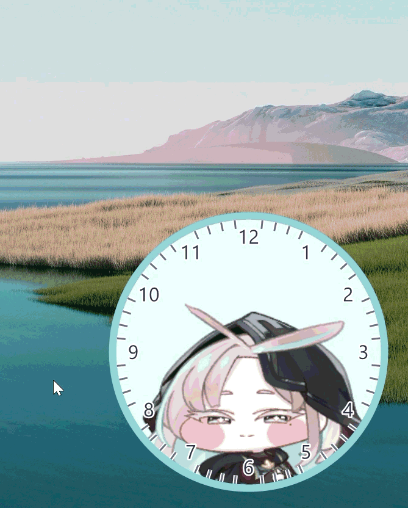

> This program was made with the help of AI.

[한국어](../../README.md) · **English** · [日本語](README.ja.md)

# Skea Clock


Make Skea your desktop clock. Check the time, pull her cheeks, or pat her head.
Other Apostles are here too!

## Download

No installation is required.

- [Download the latest version](https://github.com/junhwan123/SkeaClock/releases/latest/download/SkeaClock.exe)
- [Download the low-resolution version](https://github.com/junhwan123/SkeaClock/releases/latest/download/SkeaClock_low.exe)

Download and run the `.exe` file.
Choose the low-resolution version if the app feels sluggish or if you want a smaller download that takes fewer resources.

### Asset folder

Skea Clock creates its asset folder here when it runs.

```text
%LOCALAPPDATA%\SkeaClock
```

To remove Skea Clock and its data, delete the `.exe` file and this folder.

## Getting started



The clock appears in the lower-right corner of the screen the first time you run it.

**Right-click** the clock to open its settings menu. From there, you can change the clock's appearance, move or resize it, and switch characters.

The menu also contains the other settings described in the character guides.

## Characters

Each character has a different function. See their guides for details.

- **[Skea](../skea/README.en.md)**  
  An analog clock with alarms.
- **[Mute](../mute/README.en.md)**  
  A digital clock that shares its alarms with Skea.
- **[Kommy](../kommy/README.en.md)**  
  A timer you can set by turning Kommy's tongue. A short alarm sounds when the timer ends.
- **[Coffe](../coffe/README.en.md)**  
  A music player that can play your chosen track in the background. Coffe can make you coffee too!

The guides also cover the settings shared by all characters.

## Languages

Skea Clock supports Korean, Japanese, English, and Simplified Chinese.

You can also make a translation and use it in the app. Create your language file with the [HTML language editor](../../languages/language-editor.html).

See the [language editor guide](../../languages/Language-README.md) for instructions.

### Translation credits

Simplified Chinese — MUYANG

## Fan creation guidelines

Skea Clock is an unofficial fan project based on EPID Games' *Trickcal Revive*. It is made and distributed within the scope of the studio's fan creation guidelines. [EPID Games' official fan creation guidelines](https://epidgames.oqupie.com/portal/2399)

Rights to the original characters, setting, and other content belong to EPID Games and the respective rights holders.

At the request of EPID Games or the relevant rights holders, the materials may be changed or removed, or publication and distribution of Skea Clock may stop.
