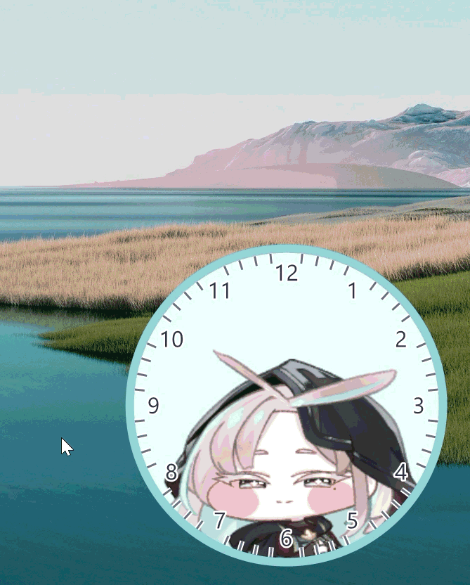

> このプログラムはAIを活用して制作しました。

[한국어](../../README.md) · [English](README.en.md) · **日本語**

# Skea Clock


スキアをデスクトップの時計にしてみましょう。時刻を確認したり、ほっぺを引っ張ったり、頭をなでたりできます。
ほかの使徒も登場します！

## ダウンロード

インストールは不要です。

- [最新版をダウンロード](https://github.com/junhwan123/SkeaClock/releases/latest/download/SkeaClock.exe)
- [低解像度版をダウンロード](https://github.com/junhwan123/SkeaClock/releases/latest/download/SkeaClock_low.exe)

ダウンロードした `.exe` ファイルを実行してください。
動作が重い場合や、負荷やファイルサイズを抑えたい場合は、低解像度版をご利用ください。

### アセットフォルダー

起動時に、次の場所にアセットフォルダーが作成されます。

```text
%LOCALAPPDATA%\SkeaClock
```

データも含めて削除したい場合は、`.exe` ファイルとこのフォルダーを削除してください。

## 使い方



初めて起動すると、画面の右下に時計が表示されます。

時計を**右クリック**すると設定メニューが開きます。時計の見た目やサイズ、位置を変えたり、キャラクターを切り替えたりできます。

ほかの設定については、各キャラクターのガイドをご覧ください。

## キャラクター

キャラクターごとに使える機能が異なります。詳しくは各ガイドをご覧ください。

- **[スキア](../skea/README.ja.md)**  
  アラームを設定できるアナログ時計です。
- **[ミュート](../mute/README.ja.md)**  
  デジタル時計です。アラームの設定はスキアと共有します。
- **[コミー](../kommy/README.ja.md)**  
  舌を回してセットするタイマーです。時間になると短いアラームが鳴ります。
- **[コーフェ](../coffe/README.ja.md)**  
  お好みの曲をバックグラウンドで再生できる音楽プレーヤーです。コーフェにコーヒーを淹れてもらうこともできます！

各ガイドには、キャラクター共通の設定も記載しています。

## 言語

Skea Clockは韓国語、日本語、英語、中国語（簡体字）に対応しています。

自分で翻訳した言語ファイルをアプリに適用することもできます。[HTML言語エディター](../../languages/language-editor.html)で言語ファイルを作成できます。

作成方法は[言語エディターのガイド（英語）](../../languages/Language-README.md)をご覧ください。

### 翻訳協力

中国語（簡体字） — MUYANG

## 二次創作ガイドライン

Skea Clockは、EPID Gamesの『トリッカル リバイブ』を題材にした非公式の二次創作プログラムです。EPID Gamesの二次創作ガイドラインで認められている範囲で制作・配布しています。[EPID Games公式の二次創作ガイドライン](https://epidgames.oqupie.com/portal/2399)

原作のキャラクターや設定などに関する権利は、EPID Gamesおよび各権利者に帰属します。

EPID Gamesまたは関係する権利者から要請があった場合は、該当する素材を修正・削除したり、プログラムの公開や配布を停止したりすることがあります。
