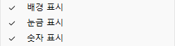
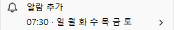
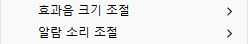
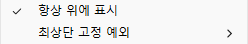
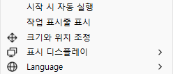
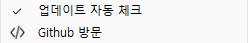

# Skea clock

**한국어** · [English](README.en.md) · [日本語](README.ja.md)

[메인 README로 돌아가기](../../README.md)

[뮤트](../mute/README.md) · [코미](../kommy/README.md) · [코페](../coffe/README.md) README 보기

스키아 아날로그 시계입니다.  
우클릭을 통해 배경, 눈금, 숫자 표시를 조정할 수 있으며 알람 기능을 사용할 수 있습니다.

### 시계 모양

**배경 표시**, **눈금 표시**, **숫자 표시**를 각각 켜거나 꺼서 원하는 모양으로 설정할 수 있습니다.

### 알람

알람을 설정하면 해당 시간에 알람이 울립니다.  
알람 기능은 스키아와 뮤트에서 모두 사용할 수 있으며, 같은 알람을 공유합니다.

**알람 추가**로 새로운 알람을 설정할 수 있으며 추가된 알람은 편집하거나 삭제할 수 있습니다.  
저장하지 않고 종료한 알람은 자동으로 삭제됩니다.

### 소리 설정

소리 크기와 알람 종류를 마음대로 조정할 수 있습니다.

**알람 파일 선택...**을 통해 사용자가 알람 소리를 선택할 수 있습니다.  
컴퓨터에 있는 음성 혹은 영상 파일을 인식하며, 재생 불가능한 파일 선택 시 자동으로 취소됩니다.  
컴퓨터에서 원본 파일이 삭제되거나 이동되면 선택이 취소됩니다.

## 공통 기능

### 항상 위에 표시 설정

**항상 위에 표시**를 켜면 다른 프로그램을 사용하면서도 시계를 볼 수 있습니다.  
체크를 해제하면 다른 창 뒤로 가려질 수 있습니다.

**최상단 고정 예외**에서 프로그램을 선택하면, 해당 프로그램을 최상단 고정에서 제외됩니다.  
해당 프로그램을 사용하는 중에는 시계가 사라지고 다른 프로그램으로 전환하면 그때 최상단으로 올라옵니다.

목록에 원하는 프로그램이 없다면 **프로그램 선택...**을 눌러 실행 파일을 직접 추가할 수 있습니다.

### 기타 항목

**시작 시 자동 실행**을 켜면 윈도우 시작 프로그램에 등록됩니다.  
컴퓨터 실행 시 자동으로 프로그램이 실행됩니다.

**작업 표시줄 표시**를 켜면 스키아 시계가 작업 표시줄에 표시되는 창이 됩니다.

**크기·위치 이동**을 통해 시계의 크기와 위치를 원하는 대로 조절할 수 있습니다.

**표시 디스플레이**를 통해 시계를 표시할 화면을 선택할 수 있습니다.  
크기 및 위치 데이터는 화면별로 따로 저장됩니다.

**Language**를 통해 언어 설정이 가능합니다.

**언어 파일 선택...**을 통해 사용자 커스텀 언어를 추가할 수 있습니다.  
언어 파일 생성은 [Language-README.md](../../languages/Language-README.md) 파일을 참고해주세요.

### 업데이트 관리

**업데이트 자동 체크**를 켜면 7일에 한 번, 프로그램 실행 시 github에 접속하여 업데이트가 있는지 확인합니다.

**Github 방문** 버튼을 통해 직접 업데이트를 확인할 수 있습니다.
